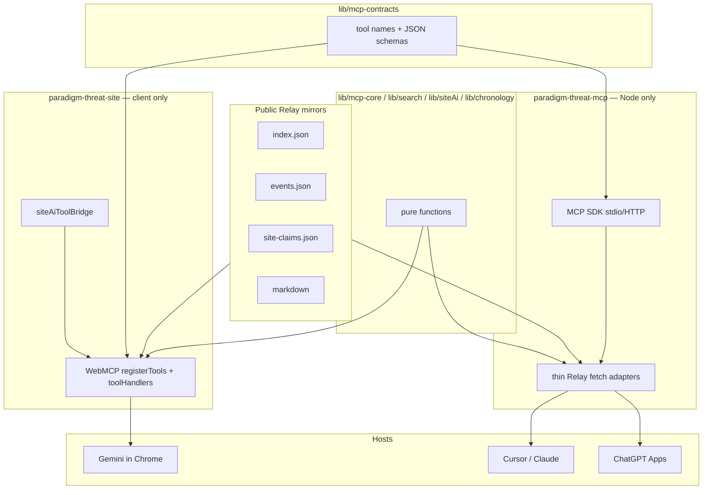

# Paradigm Threat MCP Server — Plan

> **Update (2026-07):** Discovery catalogs are **Relay QUERY** (`collection: index` / `events`), not committed `index.json` / `data/events.json`. `scripts/generate-index.py` and pre-commit catalog writers are **removed**. Prefer QUERY + `site-claims.json` + markdown GETs in implementation notes below.


How to expose Paradigm Threat research (mainstream position, credible alternates, and repo thesis) to AI agents via a **server-side Model Context Protocol (MCP)** — complementing the shipped [WebMCP integration](WEBMCP_INTEGRATION.md).

**Status:** planning  
**Last reviewed:** 2026-07-09 (chronology section added)

---

## Executive summary

**Verdict: feasible now, phased build.**

The site already ships ~70% of the retrieval and agent-contract layer in WebMCP (`search_site`, `get_site_claims`, `read_article`, `get_project_perspective`, `prepare_reply_context`). What remains:

1. A **server MCP** (stdio / HTTP) callable without an open browser tab — for Cursor, Claude Desktop, ChatGPT Apps, and other MCP hosts.
2. A **citation extraction layer** that surfaces **primary and public sources** instead of `paradigmthreat.net` URLs unless the claim is **original to the repo**.
3. Optional **mainstream-position fields** where investigations only imply the challenged default today.
4. **Chronology & date calculations** — for any timeline event, return dates under **mainstream (Scaligerian)**, **NC (New Chronology)**, and **Blip-adjusted elapsed time** (“how many years ago it actually was”).

| Channel | Feasibility (July 2026) | Notes |
|---------|-------------------------|-------|
| **Cursor / Claude Desktop** (stdio MCP) | High | Natural first ship target; reuse WebMCP handlers |
| **ChatGPT Apps / custom MCP** | High | OpenAI documents `search` + `fetch` for deep research; [MCP Apps](https://developers.openai.com/apps-sdk/mcp-apps-in-chatgpt) standard |
| **Chrome WebMCP** (current) | Shipped | Gemini-in-Chrome; tab must be open; see [WEBMCP_INTEGRATION.md](WEBMCP_INTEGRATION.md) |
| **“Any history question” quality** | Medium | Keyword search is the ceiling until semantic index or claim graph |
| **Chronology / date math** | High (with data gaps) | Blip elapsed math ships in site; multi-chronology `dates[]` mostly unpopulated |

This is **not** future tech for ChatGPT — MCP is the current integration path. The hard parts are **content modeling**, **citation discipline**, and **populating multi-chronology dates** on timeline events — not protocol wiring.

---

## Use case

When a user asks anything about history, science, or “reality”:

1. Return the **mainstream / consensus position** (fairly stated).
2. Return **credible alternate positions** (Fomenko, Electric Universe, mud-flood community, etc.) where they exist in public literature.
3. Return **Paradigm Threat’s position** when the repo has a thesis — with epistemic tiering.
4. **Cite primary sources and public URLs** — not `paradigmthreat.net` unless the claim is **original to the repo** (`site-distinctive`, author thesis sections).
5. **Answer “when did X happen?”** with structured dates across chronology frames and **years-ago estimates** (calendar vs blip-adjusted).

This is a **research adjudication API**, not a site-navigation API. WebMCP today is closer to the latter, with reply-assistant seasoning.

### Chronology use case (timeline)

When a user asks about the date of an event — by name, year, or topic:

1. Resolve the **timeline event** (`events.json` entry or nearest match).
2. Return **project / NC date** — the signed year stored on the timeline (negative = BCE).
3. Return **mainstream (Scaligerian) date** when known — from a second `dates[]` entry, Fomenko duplicate map, or documented shift table.
4. Return **elapsed time to now**:
   - **Calendar years / solar-model days** (conventional count on the project timeline).
   - **Blip-adjusted years / days** — subtract overlap with the phantom interval **670 BCE → 1053 CE** for BCE→present spans (already implemented in site UI).
5. Label **era** (Golden Age, Blip, CE 1053+, etc.) and **confidence** (`display_year: "?"`, `note`, duplicate links).

**Important:** There is no single global formula that converts every Scaligerian year ↔ NC year. The MCP must expose **per-event dates where curated**, **documented shift rules where global**, and **caveats** everywhere else — never imply precision the data does not support.

### Citation policy (hard requirement)

| Claim tier | Cite |
|------------|------|
| **Documented** (FOIA, archive, peer paper) | Primary URL from investigation § Primary Sources |
| **Public alternate literature** (Fomenko, Velikovsky, EU) | Book / paper URL; repo optional as synthesis pointer |
| **project-thesis** + **site-distinctive** | May cite repo *as synthesis* + primaries |
| **Author / Speculative** | Label clearly; primaries only if they support a sub-fact |

**Context vs citation:** The model may *read* repo markdown for reasoning. MCP responses must **list citable URLs separately** so answers cite archives and primaries, not the synthesis page.

### Research posture (server MCP)

The server MCP is a **corpus-grounded research instrument**, not an oracle. It answers from **what the repo indexes and cites** — and reports honestly when that is insufficient.

| Principle | Implication |
|-----------|-------------|
| **Corpus-first** | Every factual claim in the response trace should map to a tool result (`search_site`, `read_article`, `get_site_claims`, `get_event_dates`, `citations.json`). |
| **No silent fill-in** | If the corpus does not cover a topic, the MCP returns an explicit **coverage status** — it does not let the host model invent Paradigm Threat positions or primary citations. |
| **Host knowledge is not our citation** | Training-data mainstream summaries are **not** MCP output unless labeled `source: host_may_supplement` in the agent prompt — outside the citable bundle. |
| **Gaps are data** | “Not in corpus” and “thesis without primary” are first-class fields — they feed `submit_investigation_idea` and investigation sweeps. |
| **Suggest, don’t decide** | Align with investigation sweep spec: propose searches and open questions; never auto-edit investigations. |

---

## What already exists

### WebMCP tool surface (`lib/webmcp/`)

| Tool | Role |
|------|------|
| `search_site` | AND keyword search over merged files + timeline index |
| `get_site_claims` | Curated thesis cards from `site-claims.json` |
| `get_project_perspective` | Worldview seed (`lib/replyAssistant/projectPerspective.ts`) |
| `read_article` | Paginated markdown fetch via Relay mirrors |
| `prepare_reply_context` | Paste → extracted queries + seed articles + agent instructions |
| `format_reply_citations` | Footer / inline citation blocks (today: site canonical URLs) |
| `find_articles_for_text` | OR-ranked overlap on pasted prose |
| `expand_search_keywords` | Related-term expansion |

See [WEBMCP_INTEGRATION.md](WEBMCP_INTEGRATION.md) for full tool list and feature flags.

### Curated thesis cards (`paradigm-threat-files/site-claims.json`)

~40+ entries with `confidence`, `uniqueness`, `topics`, `canonicalPaths`, `doNotSay`. Consumed by Site AI and `get_site_claims`. Index doc: [site-ai/SITE_CLAIMS_INDEX.md](site-ai/SITE_CLAIMS_INDEX.md).

### Corpus epistemics (`paradigm-threat-files`)

- Investigations: **Author / Documented / Speculative** tiers — see `docs/PARADIGM_INVESTIGATION_INSTRUCTIONS.md` in the files repo.
- Primary-source sections: e.g. `## II. Repo Citations — Primary Sources` in dossiers.
- No parallel `mainstream/` vs `alternate/` file trees — mainstream appears as the **challenged default** inside investigations.

### Search / index pipeline

| Artifact | Location | Behavior |
|----------|----------|----------|
| QUERY `index` | `paradigm-threat-files` mirror | ~2,300 paths: title, keywords, updated |
| QUERY `events` | `paradigm-threat-timeline` mirror | Merged into client search |
| Keyword AND filter | `lib/searchIndexFilter.ts` | All terms must match |
| Ranking | `lib/search/searchRankScore.ts` | Title / slug-aware |
| Indexing | Relay `path_tree` / `content_events` on push | QUERY catalogs; no committed index JSON |

### Timeline & chronology (`paradigm-threat-timeline`)

| Artifact | Location | Behavior |
|----------|----------|----------|
| `events.json` | `paradigm-threat-timeline/data/` | Recursive event tree; signed years (`start` negative = BCE) |
| `timeline-schema.json` | same | JSON schema for entries |
| Build pipeline | `scripts/build-events-from-content.py` | Dates from filename slug + YAML frontmatter |
| Agent spec | `docs/AGENT_INSTRUCTIONS.md` | **Intended:** multiple `dates[]` per event with `source` (Scaligerian, Fomenko, Saturnian, …) |
| Blip chapter | `content/04.the-blip/04.00.00-the-blip.md` | Phantom millennium thesis: **670 BCE**, **1 CE**, **1053 CE** as one transition; ~1,723 phantom years |
| Sync tables | `content/00.overview/00.03.02-timeline-synchronization.md` | Cross-civilization year-zero clusters (4077, 3147, 2349, 685 BCE anchors) |

**Date math (shipped in site):** `components/Timeline/utils.ts`

| Constant / function | Role |
|---------------------|------|
| `BLIP_SIGNED_START` / `BLIP_SIGNED_END` | `-670` … `1053` — phantom interval |
| `calendarYearsElapsed` | Signed-year span to reference year (no year 0) |
| `formatElapsedForSignedStart` | Calendar years + solar-model days; **blip-adjusted** variant with `(blip omitted)` note |
| `formatDateRange` | Human label: `1814 CE`, `1803 CE – 1815 CE` |
| `findNearestEventToYear` | Nearest event to a signed year |
| `ERAS` in `lib/timelineJsData.ts` | Era bands: Before Creation, Golden Age, Dark Ages, Iron Age / Blip, CE bands |

**Chronology frames in this project:**

| Frame | Meaning in codebase |
|-------|---------------------|
| **Scaligerian / mainstream** | Conventional textbook chronology — the challenged default; not stored on most events today |
| **NC (New Chronology)** | Fomenko’s revision — statistical duplication / phantom centuries; “NC” in prose, not a separate date column |
| **Project timeline** | What `events.json` stores — NC + Saturnian + site synthesis on **one signed-year line** |
| **Blip** | Both an **era/event range** (`evt-670-bce-the-blip`, `-670`…`1053`) and an **elapsed-time adjustment** subtracting phantom overlap |

**Current data gap:** Schema supports `dates[].source`, `timeline_sources`, `context.mainstream`, `duplicate_of`, and `display_year` — but **most events have a single undifferentiated `dates[0]`** with no `source` tag and no parallel Scaligerian date. Multi-chronology must be **authored into timeline content** (YAML frontmatter per `AGENT_INSTRUCTIONS.md`) before MCP can return authoritative mainstream dates per event.

**Not built:** `yearsAgo` as a stored field; global Scaligerian ↔ NC converter; MCP chronology tools.

---

## Gap analysis

| Capability | Status | Impact |
|------------|--------|--------|
| Tool contracts + search | Built (WebMCP) | Reuse in server MCP |
| Thesis-level answers | `site-claims.json` | Good for ~40 topics, not full corpus |
| Primary-source citations | In markdown, not structured | Agents default to citing the site |
| Mainstream position | Implicit in prose | Must be curated or generated per topic |
| Long-paste / synonym retrieval | Weak (AND keywords) | “Why did Rome fall?” may miss chronology revision |
| Server MCP (no browser) | Not built | Blocks ChatGPT / Cursor without site tab |
| Claim opposition graph | Not built | No machine-readable mainstream ↔ alt pairs |
| Multi-chronology `dates[]` | Schema only | MCP cannot return mainstream date per event until populated |
| `yearsAgo` / elapsed API | UI only (`utils.ts`) | Not exposed to agents via WebMCP or server MCP |
| Scaligerian ↔ NC conversion | Prose / per-event notes | No shift table in machine-readable form |

**Core insight:** Content is **epistemically rich but retrieval-poor**. Investigations are written for humans and LLM chunking, not for a `get_positions(topic)` API. Timeline dates are **computation-ready for elapsed time** but **not yet multi-track for mainstream vs project**.

## WebMCP vs server MCP

| | WebMCP (browser) | Server MCP |
|--|------------------|------------|
| **Hosts** | Gemini in Chrome | ChatGPT, Cursor, Claude, VS Code |
| **Requires** | Open tab on paradigmthreat.net | HTTP endpoint or local stdio |
| **Best for** | On-site reply assistant, share, navigate | Agents with no browser tab |
| **Spec** | W3C WebML CG Draft | Linux Foundation MCP |
| **Execution** | **Always client-side** | Node process; fetches same public Relay URLs |
| **Our v1 scope** | Shipped | This plan |

### Reuse strategy: contracts + pure logic, not shared handlers

**Yes — reuse WebMCP and server MCP contracts.** No — do **not** route WebMCP through the Next.js API or move WebMCP execution server-side. The site already loads catalogs via **Relay QUERY**, plus `site-claims.json` and markdown from **Relay mirrors in the browser** (`lib/clientMergedSearchIndex.ts` explicitly avoids `/api/search-index`). Server MCP should fetch the **same public URLs** in Node, not add a proprietary API layer.

```
                    ┌─────────────────────────────────────┐
                    │  lib/mcp-contracts/  (single source) │
                    │  tool names, descriptions, schemas  │
                    └──────────────┬──────────────────────┘
                                   │
              ┌────────────────────┼────────────────────┐
              ▼                    ▼                    ▼
     lib/search/*           lib/siteAi/*      components/Timeline/utils.ts
     (pure functions)       (pure match)      (pure date math)
              │                    │                    │
    ┌─────────┴─────────┐          │          ┌─────────┴─────────┐
    ▼                   ▼          ▼          ▼                   ▼
 WebMCP              Site AI    (same fns)  Server MCP         (future tests)
 registerTools       toolBridge             stdio/HTTP
 toolHandlers        │                      thin adapters
 (browser Relay)     │                      (Node Relay fetch)
    │                │                           │
    └─ navigator.modelContext                   └─ @modelcontextprotocol/sdk
       (client only)                                  (no Next.js API)
```

#### Layer 1 — Shared tool contracts (`lib/mcp-contracts/`)

One manifest per tool — consumed by both transports:

| Field | Purpose |
|-------|---------|
| `name` | Identical across WebMCP and server MCP (`search_site`, `get_event_dates`, …) |
| `description` | Agent-facing; same wording so behavior is predictable |
| `inputSchema` | JSON Schema (subset compatible with `@mcp-b/webmcp-types` and MCP SDK) |
| `readOnly` | Maps to WebMCP `readOnlyHint` and server annotations |
| `chatGptAlias` | Optional `search` / `fetch` for ChatGPT deep research |
| `webmcpOnly` | `true` for actuation tools that must not appear on server MCP |
| `serverOnly` | `true` for tools that only make sense without a tab (rare) |

**Today:** schemas are duplicated inline in `lib/webmcp/registerTools.ts`. **Target:** `registerTools.ts` imports from `mcp-contracts` and only wires `execute`.

Optional: `tools.manifest.json` + codegen for `registerTools.ts` and server `ListTools` — only if manual drift becomes painful.

#### Layer 2 — Shared pure domain logic (already mostly exists)

These modules have **no `window` dependency** and can be imported by a Node MCP package as-is or via thin re-export:

| Module | Used by |
|--------|---------|
| `lib/searchIndexFilter.ts`, `lib/search/searchSiteQuery.ts` | `executeSearchSite` |
| `lib/siteAi/matchSiteClaims.ts` | `executeGetSiteClaims` |
| `lib/replyAssistant/*` (except browser-only paths) | reply / find tools |
| `components/Timeline/utils.ts` | chronology elapsed math |
| `lib/chronology/*` (extract from utils) | `get_event_dates`, `compute_years_ago` |

**Not shared** — stay in `lib/webmcp/` only:

| Module | Why |
|--------|-----|
| `indexStore.ts` | `typeof window` guard; browser cache |
| `searchFiltersState.ts` | DOM filter UI state |
| `executeNavigateToResult`, `executeCopyToClipboard`, `executeSetSearchFilters` | Actuation; `webmcpOnly` |
| `fetchProgress` / `withFetchReport` | UI progress reporting |

#### Layer 3 — Thin executors (parallel, not merged)

| | WebMCP executor | Server MCP executor |
|--|-----------------|---------------------|
| **Fetch** | `getWebMcpSearchIndex()` → Relay via `remoteRelay` | `fetchRelayIndex()` → same mirror URLs in Node |
| **Wrap result** | `toolJsonResult` (`@mcp-b/webmcp-types`) | Map same JSON to MCP SDK `CallToolResult` |
| **Register** | `navigator.modelContext.registerTool()` | `server.setRequestHandler(ListTools/CallTool)` |

Both call the **same pure function** with the **same args** and return the **same JSON shape**. Agents cannot tell which transport ran except for actuation tools (WebMCP only).

Example — search stays one algorithm:

```ts
// lib/mcp-core/searchSite.ts (pure)
export function searchSite(index: IndexedPathEntry[], args: SearchSiteInput): SearchSiteOutput {
  return filterAndRankSearchEntries(index, args.query, filters, args.limit)
}

// lib/webmcp/toolHandlers.ts (browser)
export async function executeSearchSite(args) {
  const index = await getWebMcpSearchIndex()
  if (!index) return toolErrorResult('...')
  return toolJsonResult(searchSite(index, parseArgs(args)))
}

// paradigm-threat-mcp/handlers.ts (Node)
export async function executeSearchSite(args) {
  const index = await fetchRelayMergedIndex()  // same JSON as browser
  return mcpJsonResult(searchSite(index, parseArgs(args)))
}
```

#### Layer 4 — Result envelope

`toolJsonResult` in `lib/webmcp/toolResult.ts` already returns `{ content, structuredContent, isError }` — aligned with MCP’s structured tool results. Server MCP adds a one-line adapter; **do not fork output shapes**.

Site AI (`lib/siteAi/siteAiToolBridge.ts`) already dispatches to the same `execute*` functions — it benefits from contract extraction without any server involvement.

### What the Next.js API is (and is not) for

| Route | MCP relevance |
|-------|----------------|
| Relay mirrors (GitLab Pages) | **Primary data path** for read tools — browser and server MCP |
| `/api/investigation-submissions` | **Write only** — `submit_investigation_idea`; OAuth on server MCP if exposed |
| `/api/search-index`, `/api/timeline-json` | Legacy / optional; **not** the MCP read path |
| New `/api/mcp/*` | **Do not build** — duplicates Relay; violates client-first design |

### WebMCP stays entirely client-side (non-negotiable)

- Tool registration and execution remain in the tab.
- No server-side proxy for search, read, claims, or chronology.
- Server MCP exists **only** for hosts that cannot call `navigator.modelContext` (Cursor, ChatGPT without site open).
- Both sides are **peers** reading public static JSON — neither is authoritative over the other.

**Recommendation:** Add `lib/mcp-contracts/` + extract pure functions into `lib/mcp-core/` (or keep in existing `lib/search` etc.). Keep `lib/webmcp/toolHandlers.ts` as the browser adapter. Ship `paradigm-threat-mcp` as a separate thin Node package that imports contracts + pure logic + Node Relay fetch — **not** a shared handler package that couples browser and server bundles.

---

## ChatGPT / platform feasibility

ChatGPT (July 2026) is a first-class MCP consumer:

- **Custom MCP servers** via [Apps SDK](https://developers.openai.com/apps-sdk/build/mcp-server) — remote HTTP, OAuth, tool discovery.
- **Deep research / company knowledge** expects read-only **`search`** + **`fetch`** tools ([compatibility schema](https://developers.openai.com/api/docs/mcp)).
- **MCP Apps** — optional iframe UI for position-comparison widgets.

### ChatGPT-specific constraints

1. **Auth** — public read-only corpus can be unauthenticated; write tools (`submit_investigation_idea`) need OAuth.
2. **Tool naming** — implement `search` / `fetch` aliases wrapping existing handlers for deep-research discovery.
3. **Structured output** — return JSON the model can reason over (see schema below).
4. **Tool descriptions** — state *when* to call (e.g. “Use when user asks about chronology, cataclysm, or alternate history”).

### Example structured response (`get_evidence_bundle`)

```json
{
  "topic": "mud flood",
  "mainstream": {
    "summary": "...",
    "sources": [{ "title": "...", "url": "..." }]
  },
  "alternatePositions": [
    {
      "label": "MFEE / Tartary chronology",
      "summary": "...",
      "tier": "project-thesis",
      "sources": [{ "title": "...", "url": "..." }]
    }
  ],
  "paradigmThreat": {
    "claimId": "mfee-mud-flood-reset",
    "tier": "project-thesis",
    "citeRepoOnlyIf": "original-thesis"
  },
  "primarySources": [],
  "openQuestions": []
}
```

---

## Architecture



### Package layout (target)

| Package / folder | Runs in | Contains |
|------------------|---------|----------|
| `lib/mcp-contracts/` | both (types only) | Tool manifest; no fetch, no React |
| `lib/mcp-core/` or existing `lib/search` etc. | both | Pure search, claims, chronology math |
| `lib/webmcp/` | **browser only** | `registerTools`, `toolHandlers`, `indexStore`, actuation |
| `paradigm-threat-mcp/` | **Node only** | MCP SDK server, `fetchRelayMergedIndex`, result adapter |

### Shared library extraction

Move or re-export **pure** modules only:

| Module | Current path | Shared? |
|--------|----------------|---------|
| Tool contracts | (new) `lib/mcp-contracts/` | Yes |
| Search + rank | `lib/search/*`, `lib/searchIndexFilter.ts` | Yes (pure) |
| Site claims | `lib/siteAi/*` | Yes (pure) |
| Reply helpers | `lib/replyAssistant/*` | Mostly pure |
| Chronology math | `components/Timeline/utils.ts` → `lib/chronology/` | Yes (pure) |
| WebMCP browser glue | `lib/webmcp/toolHandlers.ts`, `indexStore.ts` | **Browser only** |
| Relay fetch (browser) | `lib/clientMergedSearchIndex.ts` | Browser |
| Relay fetch (Node) | (new) `paradigm-threat-mcp/relayFetch.ts` | Node — same URLs, no Next API |
| Markdown fetch | `lib/webmcp/fetchArticle.ts` | Split: browser vs Node adapter |

**Do not** move `toolHandlers.ts` wholesale into a shared package — split into `mcp-core` (pure) + thin browser/Node adapters.

Site WebMCP `registerTools.ts` imports contracts and wires browser executors. Server MCP imports the same contracts and wires Node executors.

---

## Chronology & date calculations

This is a **first-class MCP capability**, not an afterthought. Many history questions reduce to “when?” — the timeline is the project’s authoritative answer, with mainstream dates as an explicit alternate track where curated.

### Signed-year convention

All timeline years use **signed integers**: negative = BCE, positive = CE. No year 0 in elapsed math (`calendarYearsElapsed` in `utils.ts`). Open lower bounds use `start: null` + `start_label` (e.g. `"∞"` for Before Creation). Uncertain dates may use `display_year: "?"` (four events today; wire into `formatDateRange` for MCP).

### Three outputs agents need

| Output | Source | Notes |
|--------|--------|-------|
| **Project / NC date** | `dates[]` where `source` is absent or `project` / `Fomenko` / `Saturnian` | Default: `dates[0]` today |
| **Mainstream (Scaligerian) date** | `dates[]` where `source: "Scaligerian"` | Must be authored; not inferable globally |
| **Years ago** | Computed at query time | `refYear` = current CE year; optional `blipAdjusted` |

### Elapsed time (years ago)

Reuse `formatElapsedForSignedStart` logic:

```
calendarYears  = years from event start → now (on project timeline)
blipOverlap    = intersection of [eventStart, now] with [-670, 1053]
blipAdjusted   = calendarYears - blipOverlapYears   (BCE events only; when overlap exists)
```

Return structured numbers, not only the UI string:

```json
{
  "elapsed": {
    "refYear": 2026,
    "calendar": { "years": 3200, "solarDays": 1168443 },
    "blipAdjusted": {
      "years": 2527,
      "solarDays": 922456,
      "phantomYearsOmitted": 673,
      "note": "Overlap with Blip interval 670 BCE – 1053 CE subtracted"
    }
  }
}
```

`solarDays` uses the same 365.25-day solar-year model as vis-timeline (`yearToDate`) — document this when agents need civil-calendar precision.

### Conversion rules (global — use with caveats)

Documented in timeline prose; ship as `chronology-framework.json` for MCP static explainer + `convert_chronology` fallbacks:

| Rule | Value | Applies when |
|------|-------|--------------|
| **Blip phantom span** | 670 + 1053 = **1,723 years** | Elapsed-time adjustment, not year relabeling |
| **Blip anchor equivalence** | 670 BCE ≈ 1 CE ≈ 1053 CE | Same transition in project thesis |
| **Fomenko duplicate shift** | Often **+1000** or **+1053** years | Per `duplicate_of` / event `note` only |
| **Documented table shifts** | **333**, **1053**, **1800** years | Synchronization appendix tables — not per-event mapped in data yet |
| **Real history span** | ~**3,528** orbital years (per Blip chapter) | Framework context, not per-event |

`convert_chronology` must return `{ result, method, confidence, caveats[] }` and **never** silently apply a global shift when the event has curated multi-`dates[]`.

### Multi-date event schema (target state)

Per `paradigm-threat-timeline/docs/AGENT_INSTRUCTIONS.md`, each event should carry:

```yaml
dates:
  - start: 1774
    source: project          # or omit — project default
    note: "Pugachev rebellion (project timeline)"
  - start: 1774
    source: Scaligerian
    note: "Same year on conventional timeline for this event"
  - start: 774
    source: Fomenko
    note: "Duplicate cluster; see duplicate_of"
duplicate_of: evt-...
```

MCP reads **all** `dates[]` entries and groups by `source`. Fomenko duplicates link via `duplicate_of` / `related_events`.

### Flattened lookup artifact (new)

`scripts/build-chronology-index.py` (timeline repo) → `data/chronology-index.json`:

```json
{
  "events": [
    {
      "id": "evt-1774-pugachev",
      "title": "...",
      "md_path": "...",
      "datesBySource": {
        "project": { "start": 1774 },
        "Scaligerian": { "start": 1774 },
        "Fomenko": { "start": 774, "note": "+1000 duplicate" }
      },
      "era": "CE 1800+",
      "duplicate_of": null,
      "related_events": []
    }
  ],
  "eras": [ "... from ERAS constant ..." ],
  "framework": { "blip": { "start": -670, "end": 1053, "phantomYears": 1723 } }
}
```

Built from `events.json` on pre-commit; MCP loads this instead of walking the tree at runtime.

### Chronology MCP tools

#### `get_event_dates` (primary)

```typescript
// Input: eventId | md_path | titleQuery (fuzzy)
// Output:
{
  eventId, title, md_path, era,
  dates: {
    project: { start, end?, label, note?, display_year? },
    mainstream?: { start, end?, source: "Scaligerian", note? },
    fomenko?: { start, end?, note? },
    all: TimelineDate[]   // raw dates[] pass-through
  },
  elapsed: { calendar, blipAdjusted? },
  links: { timelineUrl, related_events?, duplicate_of? }
}
```

#### `compute_years_ago`

```typescript
// Input: signedYear OR eventId; optional refYear (default: now); blipAdjust?: boolean
// Output: { signedYear, formatted, elapsed: { calendar, blipAdjusted? }, era }
```

For ad-hoc questions (“how long ago was 2349 BCE?”) without resolving a full event.

#### `convert_chronology`

```typescript
// Input: year, from: "project"|"scaligerian"|"fomenko", to: ..., eventId?: string
// Output: { year, formatted, method, confidence: "curated"|"shift-rule"|"unsupported", caveats[] }
```

If `eventId` provided, prefer curated `dates[]` over global rules.

#### `get_event_by_year`

Nearest event(s) to a signed year — wraps `findNearestEventToYear`; optional `source` filter.

#### `list_era_events`

Filter flattened index by era (`Golden Age`, `Blip`, `CE 1053-1499`, …) or signed-year range.

#### `get_chronology_framework`

Static JSON explainer: NC, Blip, Scaligerian, Saturnian year-zero table (4077 / 3147 / 2349 / 685 BCE), phantom-year math, links to timeline chapter markdown. No computation — orientation for agents before calling `get_event_dates`.

#### `open_timeline_event` (WebMCP parity)

Already shipped in WebMCP; include in server MCP for navigation URL.

### Example: `get_event_dates` response

```json
{
  "eventId": "evt-the-mudflood-world-cataclysm",
  "title": "The Mudflood World Cataclysm",
  "era": "CE 1800+",
  "dates": {
    "project": { "start": 1774, "label": "1774 CE" },
    "mainstream": null
  },
  "elapsed": {
    "refYear": 2026,
    "calendar": { "years": 252, "solarDays": 92025 },
    "blipAdjusted": null
  },
  "chronologyNotes": [
    "CE events after 1053 do not receive blip elapsed adjustment.",
    "MFEE thesis ties this event to Pugachev 1774, not Napoleon.",
    "mainstream is null until source: Scaligerian is authored on this event."
  ]
}
```

### Data authoring priority (timeline repo)

To make chronology MCP authoritative, populate in this order:

1. **High-traffic events** — Blip anchors, MFEE/Pugachev, Golden Age catastrophes, major wars.
2. **Fomenko duplicate pairs** — `duplicate_of` + dual `dates[]` with `note` explaining shift.
3. **Events users ask about by mainstream year** — add `source: Scaligerian` even when year matches project (disambiguates frame).
4. **Synchronization table rows** — appendix date tables → structured `dates[]` on linked events.

Track progress in timeline `validate-events.py` — warn when `type: event` has no `Scaligerian` date and mainstream year is known from prose.

---

## Proposed MCP tools

### Phase 1 — parity with WebMCP + chronology (read-only)

| Tool | Description | ChatGPT alias |
|------|-------------|---------------|
| `search_site` | Keyword search over index | `search` |
| `read_article` | Paginated markdown by repo path | `fetch` |
| `get_site_claims` | Match question → thesis cards | — |
| `get_project_perspective` | Worldview seed (not evidence) | — |
| `get_article_context` | TL;DR, keywords, canonical URL | — |
| `list_index_entries` | Browse index with prefix filter | — |
| `get_event_dates` | Event → multi-frame dates + years ago | — |
| `compute_years_ago` | Signed year → elapsed (optional blip adjust) | — |
| `get_chronology_framework` | NC / Blip / Scaligerian explainer JSON | — |
| `get_event_by_year` | Nearest timeline event to a year | — |
| `list_era_events` | Events in era band or year range | — |
| `open_timeline_event` | Canonical timeline URL for event id | — |

### Phase 2 — evidence bundle + chronology conversion (citation policy)

| Tool | Description |
|------|-------------|
| `get_evidence_bundle` | Topic / claimId / path → mainstream summary, alt positions, primary sources, `repoSynthesisAllowed`, **`ResearchEnvelope`** |
| `research_status` | Lightweight coverage check — search + claims + chronology + gap summary before deep read |
| `format_reply_citations` | Extend with `preferPrimary: true` — emit primary URLs before site URLs |
| `convert_chronology` | Year or eventId across project / Scaligerian / Fomenko with confidence + caveats |

### Phase 3 — optional

| Tool | Description |
|------|-------------|
| `search_semantic` | Embedding or FTS over body chunks |
| `get_position_graph` | Machine-readable mainstream ↔ alt edges |
| `submit_investigation_idea` | Write path; OAuth-gated; mirrors WebMCP submit |

### Agent system prompt fragment (ship with MCP)

> Prefer `primarySources` over paradigmthreat.net. Cite the repo only when `repoSynthesisAllowed` is true or the user explicitly asks for Paradigm Threat’s synthesis. Label **project-thesis**, **documented**, and **speculative** tiers in prose.
>
> For dates: call `get_event_dates` or `compute_years_ago` instead of estimating. Present **project (NC) date**, **mainstream (Scaligerian) date** when returned, and **blip-adjusted years ago** when the event is BCE-spanning. State when mainstream date is missing or shift rules are approximate.
>
> **When `coverage` is not `covered`:** Do not invent citations or repo positions. State what was searched, what was missing, and use `suggestedNextSteps`. You may supplement with general knowledge only if labeled **outside corpus — not citable via this MCP**.

---

## Research coverage & honest limits

Research-focused server MCP must answer two hard questions explicitly:

1. **We don’t have an answer** — topic not in corpus or no confident match.
2. **Research may exist elsewhere** — alternate tradition or mainstream literature — but **not indexed here** and **no citable URL** in our data.

### Coverage status enum

Every research tool response includes (or wraps) a `ResearchEnvelope`:

```typescript
type CoverageStatus =
  | 'covered'           // corpus match + readable path; cite primaries or repo thesis per policy
  | 'partial'           // related material exists; thesis thin or citations incomplete
  | 'tangential'        // keyword overlap only; low match score
  | 'not_in_corpus'     // search + claims + timeline found nothing above threshold
  | 'chronology_only'   // timeline event exists; no investigation depth
  | 'open_question'     // listed in investigation §9 / weak-points; explicitly unresolved in repo

type ResearchEnvelope = {
  coverage: CoverageStatus
  confidence: 'high' | 'medium' | 'low'
  searched: { queries: string[]; toolsCalled: string[] }
  corpusHits: { path: string; title: string; score: number; kind: 'article' | 'timeline' | 'claim' }[]
  nearMisses?: { path: string; title: string; score: number; whyNotUsed: string }[]
  gaps: string[]                    // human-readable what's missing
  openQuestions?: string[]          // from indexed investigation §9
  doNotSay?: string[]               // from matched site-claims
  citableSources: CitableSource[]   // may be empty — empty is valid
  repoSynthesis?: { allowed: boolean; paths?: string[]; tier?: string }
  externalTraditions?: ExternalTraditionPointer[]  // curated only; not invented
  mainstream?: MainstreamBlock
  suggestedNextSteps: SuggestedStep[]
  hostMaySupplement?: boolean       // true when host model may add general knowledge, labeled non-citable
}
```

### Threshold rules (when to say what)

| Signal | Threshold | `coverage` |
|--------|-----------|------------|
| `get_site_claims` match | `matchScore >= 8` (topic/demo) | contributes to `covered` |
| `search_site` top hit | `score >= rank threshold` (tune via eval set) | `covered` or `partial` |
| Only low-score hits | best score below threshold | `tangential` |
| Zero hits after `expand_search_keywords` | — | `not_in_corpus` |
| Timeline event, no articles | event resolved | `chronology_only` |
| Hit dossier with §9 open questions | question matches query | `open_question` |

Return **`partial`** when repo has a **project-thesis** but `citableSources` is empty or only secondary — never upgrade to `covered` without a primary or explicit `repoSynthesis.allowed`.

### `MainstreamBlock` — three sourcing tiers

Avoid inventing mainstream summaries. Structured field:

```json
{
  "summary": null,
  "sourceTier": "unavailable",
  "note": "No Scaligerian summary curated for this topic in site-claims or timeline."
}
```

| `sourceTier` | Meaning | Agent may… |
|--------------|---------|------------|
| `curated` | `mainstreamSummary` in site-claims or timeline note | Cite `mainstreamSources` URLs |
| `host_may_supplement` | Corpus silent; envelope sets `hostMaySupplement: true` | State conventional view in own words; **label as outside MCP corpus** |
| `unavailable` | Do not guess | Say mainstream position was **not retrieved from this tool** |

Default for long-tail queries: **`unavailable`** — not host hallucination dressed as MCP output.

### When we have no answer (`not_in_corpus`)

**Return structure, not prose excuses.** Example:

```json
{
  "coverage": "not_in_corpus",
  "confidence": "high",
  "searched": {
    "queries": ["philadelphia experiment time travel", "montauk"],
    "toolsCalled": ["research_status", "search_site", "get_site_claims", "expand_search_keywords"]
  },
  "corpusHits": [],
  "nearMisses": [
    {
      "path": "events/philadelphia/the-philadelphia-experiment-was-not-time-travel.md",
      "title": "The Philadelphia Experiment Was Not Time Travel",
      "score": 4,
      "whyNotUsed": "below relevance threshold; query may need reframing"
    }
  ],
  "gaps": [
    "No site-claim card matches this question",
    "No investigation § Primary Sources block indexed for this exact topic"
  ],
  "citableSources": [],
  "repoSynthesis": { "allowed": false },
  "mainstream": { "summary": null, "sourceTier": "unavailable" },
  "suggestedNextSteps": [
    { "action": "rephrase_query", "detail": "Try: philadelphia degaussing 1943 navy" },
    { "action": "read_near_miss", "path": "events/philadelphia/..." },
    { "action": "submit_investigation_idea", "detail": "Request dossier if topic should be covered" },
    { "action": "external_search", "detail": "MCP does not search the open web; user or host must find primaries" }
  ],
  "hostMaySupplement": true
}
```

**Agent-facing wording (templates):**

- **not_in_corpus:** “This MCP corpus does not cover *[topic]*. Searched: *[queries]*. No citable sources returned. *[optional: nearest related article]*.”
- **tangential:** “Related material exists but is weakly matched. Treat as exploratory, not authoritative for this question.”
- **open_question:** “The repo lists this as an **open question** in *[investigation path]* — not adjudicated.”

**Never say** when `not_in_corpus`:

- “The site believes…” (no claim matched)
- “According to primary sources…” (empty `citableSources`)
- A paradigmthreat.net URL as if it answers the question (unless `nearMiss` path is explicitly offered as **related**, not **answering**)

### When research exists but not in repo (no citation)

Separate three cases — MCP must distinguish them in `externalTraditions` / `gaps`:

| Case | MCP field | What we say |
|------|-----------|-------------|
| **A. Broader tradition exists, curated pointer** | `externalTraditions[]` with public URL/ISBN | “Outside this repo: *[Fomenko / EU / etc.]* discusses related chronology — see pointer. **Not verified or endorsed here.**” |
| **B. Tradition likely exists, not indexed** | `gaps: ["prior art not indexed"]`, `uniqueness: site-distinctive` on related claim | “This may appear in alternate literature; **this MCP has no citable pointer**. Host general knowledge is not a Paradigm Threat citation.” |
| **C. Author thesis, no third-party cite found** | `repoSynthesis.allowed: true`, empty `citableSources`, tier `speculative` | “**Project thesis only** — no primary or secondary citation in corpus. Treat as hypothesis; see investigation §8 author claims.” |

`external-traditions.json` (curated build artifact) — **not** web search:

```json
{
  "topics": ["chronology revision", "phantom time"],
  "traditions": [
    {
      "id": "fomenko-nc",
      "label": "Anatoly Fomenko — New Chronology",
      "publicRefs": [{ "title": "History: Fiction or Science?", "type": "book" }],
      "relation": "adjacent-not-endorsed",
      "note": "NC framework; repo does not duplicate full argument"
    }
  ]
}
```

Only include `publicRefs` with real titles/URLs — **never fabricate**.

**Phrasing for case B (most common pain point):**

> “Alternate research on *[topic]* may exist in *[tradition name if known from external-traditions.json]*, but **this tool did not return a citable source**. Paradigm Threat has not indexed a dossier for this question. Do not cite paradigmthreat.net as evidence for *[specific claim]*.”

### `suggestedNextSteps` actions

| `action` | When |
|----------|------|
| `rephrase_query` | Low hits; offer `expand_search_keywords` terms |
| `read_near_miss` | `tangential` — path + score |
| `read_article` | `partial` — best dossier path |
| `get_event_dates` | date question with timeline hit |
| `submit_investigation_idea` | gap worth covering |
| `external_search` | user/host must find primaries outside MCP |
| `check_open_questions` | link to `open-questions-index.json` row |
| `host_supplement_ok` | envelope allows labeled non-corpus mainstream context |

### New build artifacts (research)

| Artifact | Generator | Role |
|----------|-----------|------|
| `open-questions-index.json` | parse investigation §9 / weak-points tables | `open_question` coverage |
| `external-traditions.json` | hand-curated + validated | pointers when repo is silent |
| `gaps-registry.json` (optional) | sweep plans / manual | known corpus holes agents should not pretend are filled |

### `doNotSay` propagation

When `get_site_claims` matches, copy `doNotSay[]` into envelope — agents must not contradict these even when host knowledge suggests otherwise.

### Debunk & adjacent-discard guardrails

Ship in agent prompt (from `METHODS_DEBUNK_OVERREACH_ADJACENT_DISCARD.md`):

- Scope debunks to the **specific claim** evaluated.
- Do not use “debunked” as a conversation-stopper.
- **Partial corpus coverage ≠ whole topic false.**

### Research tool orchestration

Prefer one high-level tool for agents:

#### `research_status` (or fat `get_evidence_bundle`)

```typescript
// Input: question (string), depth?: 'quick' | 'full'
// Runs: matchSiteClaims → search_site → expand if low hits → timeline lookup → citations extract
// Output: ResearchEnvelope + optional excerpt paths (no full markdown unless depth: 'full')
```

Keeps hosts from calling `search_site` alone and over-interpreting weak hits.

---

## Build artifacts (new)

### `citations.json` (files repo or MCP server)

Generated at autogen time by `scripts/extract-citations.py` (new):

- Parse `## … Primary Sources` sections and external markdown links.
- Key by article path; tag each URL: `primary | secondary | repo-internal`.
- Feed `get_evidence_bundle`.

### `site-claims.json` extensions (Phase 2)

Optional fields per claim:

```json
{
  "mainstreamSummary": "One fair paragraph.",
  "mainstreamSources": [{ "title": "...", "url": "..." }],
  "primarySourceIds": ["cia-tonkin-2005", "fomenko-history-2003"]
}
```

Validation: extend `validate-site-claims` in files repo autogen.

### `chronology-index.json` + `chronology-framework.json` (timeline repo)

| Artifact | Generator | Role |
|----------|-----------|------|
| `chronology-index.json` | `build-chronology-index.py` | Flattened events, `datesBySource`, era, duplicates |
| `chronology-framework.json` | Hand-curated + validated | Blip constants, NC/Scaligerian glossary, year-zero table, global shift rules with caveats |

Hook `build-chronology-index.py` into timeline pre-commit alongside `build-events-from-content.py`.

### `open-questions-index.json` + `external-traditions.json` (research envelope)

| Artifact | Generator | Role |
|----------|-----------|------|
| `open-questions-index.json` | parse investigation §9 / weak-points | `open_question` status; linkable falsifiable hooks |
| `external-traditions.json` | hand-curated | Public refs to alternate literature when repo is silent |

### Mainstream summaries — sourcing strategy

| Approach | Quality | Effort |
|----------|---------|--------|
| **A. Curated** — `mainstreamSummary` on top claims | Highest | Manual per claim |
| **B. LLM sweep** — drafts into JSON, human review | High | Batch; see files repo `INVESTIGATION_LLM_SWEEP.md` |
| **C. Runtime** — host model states mainstream from training | Variable | Zero build; MCP supplies alts + primaries only |

**Recommended:** A + B for top ~50 topics; C for long tail.

---

## Implementation phases

### Phase 1 — Server MCP on Vercel (shipped v0.1)

- [x] `app/api/mcp/route.ts` — Streamable HTTP, `MCP_SERVER_ENABLED` gate
- [x] `lib/mcp/*` — Relay fetch, server handlers, research envelope
- [x] Stateless transport (one per request — serverless-safe)
- [x] `scripts/validate-mcp.mjs` + `npm run validate:mcp`
- [x] Deploy doc: [MCP_VERCEL_DEPLOY.md](MCP_VERCEL_DEPLOY.md)
- [x] Set `MCP_SERVER_ENABLED=1` on Vercel production (live `/api/mcp` initialize succeeds)
- [x] Run `validate:mcp` against production after deploy

**Exit criteria:** `node scripts/validate-mcp.mjs https://old.paradigmthreat.net` passes.

### Phase 0 — Contract extraction (1 week, site repo)

- [ ] Create `lib/mcp-contracts/` — move schemas from `registerTools.ts`; no behavior change.
- [ ] Refactor `toolHandlers.ts` to call pure functions in `lib/mcp-core/` (search, claims, chronology).
- [ ] Mark actuation tools `webmcpOnly: true` in manifest.
- [ ] WebMCP remains 100% client-side; Site AI bridge unchanged.

**Exit criteria:** WebMCP regression tests pass; contracts live in one file.

### Phase 1 — Server MCP (4–6 weeks)

- [ ] Scaffold `paradigm-threat-mcp` (sibling repo or `paradigm-threat-site/packages/mcp-server`).
- [ ] TypeScript + `@modelcontextprotocol/sdk`; import `mcp-contracts` + `mcp-core`.
- [ ] stdio transport for Cursor / Claude Desktop.
- [ ] HTTP transport for remote hosts (Fly.io, Linode — TBD).
- [ ] `fetchRelayMergedIndex()` in Node — **same Relay URLs as browser**; no `/api/mcp/*`.
- [ ] Wire Phase 1 tools via Node thin adapters (parallel to WebMCP, not shared `toolHandlers`).
- [ ] Cache `index.json`, `site-claims.json`, `events.json`, `chronology-index.json` on TTL.
- [ ] Implement `get_event_dates`, `compute_years_ago`, `get_chronology_framework`.
- [ ] Local test: MCP Inspector + Cursor config snippet in repo README.

**Exit criteria:** Cursor can answer “when was the mud flood / Pugachev rebellion?” with project date, elapsed years, and era — without the site tab open.

### Phase 1b — Timeline multi-date authoring (ongoing, timeline repo)

- [ ] Add `source: Scaligerian` (and Fomenko where applicable) to priority events in YAML frontmatter.
- [ ] Ship `build-chronology-index.py` + `chronology-framework.json`.
- [ ] Extend `validate-events.py` — report events missing mainstream date when prose implies one.
- [ ] Wire `display_year: "?"` into MCP `formatDateRange` output.

**Exit criteria:** Top 50 events return both `project` and `mainstream` in `get_event_dates` without `convert_chronology` heuristics.

### Phase 2 — Citation bundle (2–4 weeks)

- [ ] `scripts/extract-citations.py` → `citations.json`.
- [ ] Hook into `paradigm-threat-files` `npm run autogen`.
- [ ] Implement `get_evidence_bundle`.
- [ ] Extend `format_reply_citations` with `preferPrimary`.
- [ ] Pilot `mainstreamSummary` on 10 high-traffic `site-claims` entries.
- [ ] Document schema in files repo `docs/` (cross-link only).

**Exit criteria:** Agent answering “what is the mud flood?” cites archive.org / books, not paradigmthreat.net, unless citing MFEE synthesis.

### Phase 2b — Research coverage envelope (2–3 weeks)

- [ ] Define `ResearchEnvelope` type on all research tool responses.
- [ ] Implement `research_status` (or embed envelope in `get_evidence_bundle`).
- [ ] Score thresholds: when to say **covered** vs **partial** vs **not_in_corpus**.
- [ ] Index investigation §9 open questions into `open-questions-index.json` (build artifact).
- [ ] Ship `external-traditions.json` — curated pointers to public alternate literature (Fomenko, Velikovsky, EU, etc.) **without** implying repo coverage.
- [ ] Agent prompt + `doNotSay` propagation from `site-claims.json`.

**Exit criteria:** Query with zero index hits returns `coverage: not_in_corpus` with `nearMisses` and `suggestedNextSteps` — no fabricated citations.

### Phase 3 — Retrieval upgrade (optional)

Pick one path:

| Approach | Pros | Cons |
|----------|------|------|
| **Body chunk index** (SQLite FTS) | No GPU; exact passages | Build + maintain |
| **Embeddings** (local or API) | Synonym / concept match | Cost; needs eval set |
| **Claim graph JSON** | Clean opposition API | Authoring burden |

Aligns with `paradigm-threat-llm` RAG notes; **not required** for Phase 1–2.

**Exit criteria:** Eval set of 50 questions hits relevant dossier in top 3 without exact keywords.

### Phase 4 — ChatGPT App

- [ ] Register MCP server in OpenAI developer settings.
- [ ] `search` / `fetch` compatibility verified against deep research.
- [ ] Optional MCP App widget: Mainstream | Alternates | Paradigm Threat cards.
- [ ] OAuth only if write tools ship.

### Phase 5 — Discovery

- [ ] Static `https://paradigmthreat.net/llms.txt` — MCP endpoint, `site-claims.json`, tool manifest.
- [ ] Link from `paradigm-threat-files/page.md` discovery hub (optional).

---

## Making corpus data available for context

| Mechanism | Role |
|-----------|------|
| `site-claims.json` | Curated Q&A; MCP resource |
| `index.json` | Discovery |
| Investigation chunks | Model context; citations from `citations.json` |
| `get_project_perspective` | Voice / stance seed only |
| Relay mirrors | Server fetches markdown without git clone |
| `events.json` | Timeline alternate layer |
| `chronology-index.json` | Flattened multi-source dates + era |
| `get_event_dates` / `compute_years_ago` | Authoritative date math for agents |

Published URLs (Relay / GitLab Pages) are the runtime source of truth; MCP server does not require a local files-repo checkout in production.

---

## Risks and mitigations

| Risk | Mitigation |
|------|------------|
| Agents cite repo by default | `get_evidence_bundle` + `preferPrimary`; host system prompt |
| Mainstream strawman | Curated `mainstreamSummary`; existing `doNotSay` on claims |
| Keyword search misses questions | `expand_search_keywords`; Phase 3 semantic |
| Platform policy (sensitive topics) | Read-only research tool; tier labels; primary anchoring |
| Stale index | Reuse files autogen; MCP TTL refresh |
| Duplicating WebMCP logic | Shared contracts + pure `mcp-core`; parallel thin adapters |
| Stale tarball / mirror pitfall | Same Relay failover patterns as site search |
| False precision on NC ↔ mainstream conversion | `confidence` + `caveats[]` on every `convert_chronology` result; prefer curated `dates[]` |
| Mainstream date invented by agent | Return `mainstream: null` when not in data; `sourceTier: unavailable` |
| Host fills gaps with hallucinated citations | `ResearchEnvelope`; empty `citableSources` is valid; `hostMaySupplement` flag |
| Weak search hit over-interpreted | Score thresholds; `tangential` vs `covered`; `research_status` orchestration |
| “Alternate research exists” without URL | `externalTraditions` curated only; case B phrasing template |
| Agent cites repo for unanswered question | `not_in_corpus` + `repoSynthesis.allowed: false`; `doNotSay` |

---

## Effort vs payoff

| Deliverable | Effort | Unlocks |
|-------------|--------|---------|
| stdio MCP for Cursor | S | Daily research workflow |
| HTTP MCP + `search` / `fetch` | M | ChatGPT Apps |
| `citations.json` + evidence bundle | M | Citation policy |
| `mainstream` fields on site-claims | M–L | Fair “both sides” answers |
| Chronology tools + `chronology-index.json` | M | “When did X happen?” across frames |
| Research envelope + honest limits | M | Trustworthy “we don’t know” / no citation |
| `open-questions-index.json` | M | Surface unresolved repo questions |
| Multi-date timeline authoring | L (ongoing) | Authoritative Scaligerian per event |
| Semantic search | L | True “any question” |
| Full claim graph | L | Structured opposition API |

---

## Related docs

| Doc | Path |
|-----|------|
| WebMCP (shipped) | [WEBMCP_INTEGRATION.md](WEBMCP_INTEGRATION.md) |
| Vercel deploy | [MCP_VERCEL_DEPLOY.md](MCP_VERCEL_DEPLOY.md) |
| Site claims index | [site-ai/SITE_CLAIMS_INDEX.md](site-ai/SITE_CLAIMS_INDEX.md) |
| Investigation authoring | `paradigm-threat-files/docs/PARADIGM_INVESTIGATION_INSTRUCTIONS.md` |
| Debunk / adjacent discard | `paradigm-threat-files/docs/METHODS_DEBUNK_OVERREACH_ADJACENT_DISCARD.md` |
| Investigation sweep (gaps / prior art) | `paradigm-threat-files/docs/INVESTIGATION_LLM_SWEEP.md` |
| Site claims source | `paradigm-threat-files/site-claims.json` |
| Timeline agent instructions | `paradigm-threat-timeline/docs/AGENT_INSTRUCTIONS.md` |
| Blip thesis (source) | `paradigm-threat-timeline/content/04.the-blip/04.00.00-the-blip.md` |
| Timeline date math (site) | `components/Timeline/utils.ts` |
| Timeline schema | `paradigm-threat-timeline/data/timeline-schema.json` |
| LLM / GPU RAG notes | `paradigm-threat-llm/docs/PLAN_LINODE_GPU.md` |
| OpenAI MCP for ChatGPT | https://developers.openai.com/api/docs/mcp |
| MCP Apps in ChatGPT | https://developers.openai.com/apps-sdk/mcp-apps-in-chatgpt |

---

## Open questions

1. **Repo layout** — sibling `paradigm-threat-mcp` vs `paradigm-threat-site/packages/mcp-server`?
2. **Hosting** — Fly.io vs Linode (align with `paradigm-threat-llm`) vs serverless edge?
3. **Public vs gated** — fully public read MCP vs API key for abuse control?
4. **ChatGPT app branding** — “Paradigm Threat Research” vs neutral “Alternate History Sources”?
5. **Phase 3 pick** — FTS chunks vs embeddings vs defer until eval set exists?
6. **Mainstream date sourcing** — manual YAML per event vs batch from synchronization tables vs leave null until curated?
7. **Blip-adjusted default** — always return both calendar and blip-adjusted for BCE events, or only when `blipAdjust: true`?
8. **Contract codegen** — hand-maintained `mcp-contracts/` vs `tools.manifest.json` codegen?

---

## Next actions

1. Decide repo layout and hosting target.
2. Create `lib/mcp-contracts/` — extract schemas from `registerTools.ts` into manifest; WebMCP imports it (no behavior change).
3. Define `ResearchEnvelope` TypeScript type in `lib/mcp-core/researchEnvelope.ts`.
4. Extract pure `searchSite()`, `getSiteClaimsForQuery()`, chronology helpers into `lib/mcp-core/`; refactor `toolHandlers.ts` to call them (WebMCP still client-only).
5. Prototype `research_status` with coverage thresholds on 10 eval questions (5 covered, 5 not_in_corpus).
6. Add `fetchRelayMergedIndex()` in `paradigm-threat-mcp` — Node fetch mirroring `clientMergedSearchIndex` URLs (no Next API).
7. Scaffold stdio MCP wiring contracts + Node adapters + `get_event_dates`, `research_status`.
8. Draft `external-traditions.json` with ~10 tradition pointers (Fomenko, Velikovsky, EU, Illig, etc.).
9. Prototype `extract-citations.py` + `open-questions-index.py` on five investigation files.
