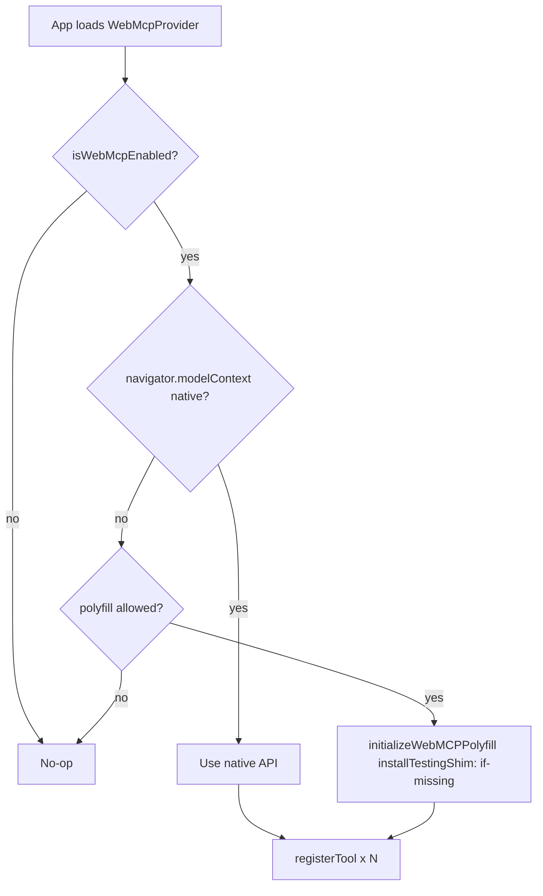

# WebMCP Integration Plan

How to add [Chrome WebMCP](https://developer.chrome.com/docs/ai/webmcp) (Web Model Context Protocol) to paradigm-threat-site so AI agents can discover and call structured site tools — with optional polyfill fallback when native support is absent.

**Status:** implemented (behind `NEXT_PUBLIC_WEBMCP_ENABLED=1`)  
**Last reviewed:** 2026-06-17

### Implementation status (June 2026)

| Area | Status |
|------|--------|
| WebMCP tools (`lib/webmcp/`) | Shipped — search, navigation, share, reply investigation |
| Feature flags | `NEXT_PUBLIC_WEBMCP_ENABLED`, `NEXT_PUBLIC_WEBMCP_ACTUATION`, `NEXT_PUBLIC_WEBMCP_POLYFILL` (dev) |
| `/reply` UI | In-page draft via Prompt API + WebMCP tools (native or polyfill) |
| Site AI chat | Global FAB + TTS dock button; localStorage session; Q&A-first search |
| Investigation submissions | `/submit` form + `submit_investigation_idea` tool → Postgres via `/api/investigation-submissions`. **No admin UI** — triage and `DELETE` rows in Neon/Cursor when investigations are written; see [`docs/INVESTIGATION_SUBMISSIONS.md`](INVESTIGATION_SUBMISSIONS.md) |
| Reply assistant | Browser AI drafts reply; tools search/read site corpus |
| Project perspective seed | `get_project_perspective`, `lib/replyAssistant/projectPerspective.ts` |
| Polyfill | Strict `@mcp-b/webmcp-polyfill` when native missing; does not enable `/reply` |

---

## Executive summary

paradigm-threat-site is a content-heavy Next.js app with **client-side keyword search**, **share/clipboard composition**, **timeline navigation**, and **WebMCP tools** for AI agents when the feature flag is on.

Recommended approach:

1. **Ship behind a feature flag** (`NEXT_PUBLIC_WEBMCP_ENABLED=1`), matching existing ops patterns in `lib/siteOpsFeature.ts`.
2. **Use the strict polyfill** (`@mcp-b/webmcp-polyfill`) only when native `navigator.modelContext` is missing — never override native Chrome.
3. **Start with read-mostly tools** (search, navigate, compose copy, forum reply retrieval) before write/actuation tools (clipboard write, filter toggles).
4. **Test with the polyfill testing shim** in CI, then validate natively with Chrome flag + Model Context Tool Inspector.

WebMCP is **progressive enhancement**: the site works identically for humans when the flag is off or the browser has no agent.

---

## What is WebMCP (and what it is not)

| | WebMCP | Anthropic MCP (server) |
|---|---|---|
| **Runs where** | Browser tab / webview (client JS) | Backend process |
| **API** | `navigator.modelContext.registerTool()` | MCP server over stdio/HTTP |
| **Agent access** | Gemini in Chrome (origin trial), future Chromium agents | Cursor, Claude Desktop, etc. |
| **Spec status** | W3C WebML CG Draft (Feb 2026) | Linux Foundation |
| **Our use** | Expose site search, navigation, share copy | Not in scope for v1 |

**Availability (June 2026):**

- **Origin trial:** Chrome 149–156 — register production origin, real users, Gemini in Chrome as primary consumer.
- **Local dev:** `chrome://flags/#enable-webmcp-testing` (Chrome 146+).
- **Requirements:** origin-isolated document; `tools` Permissions-Policy (defaults to `self`).
- **Not supported:** headless tool calls (tab must be open); cross-origin iframe tools unless `allow="tools"`.

---

## Why paradigm-threat-site is a good fit

The site already has **structured, testable operations** that agents struggle to do reliably via DOM actuation:

| Existing capability | Key files | Agent pain without WebMCP |
|---|---|---|
| Keyword search (AND terms) | `lib/searchIndexFilter.ts`, `lib/clientMergedSearchIndex.ts` | Guessing search input, misreading result links |
| Path → query suggestions | `lib/pathSearchQuery.ts` (tested, not wired to UI) | 404 recovery, “did you mean” |
| Share / clipboard text | `lib/share/composeShareText.ts`, `ShareCopyModal.tsx` | Platform char limits, duplicate URLs, hashtag rules |
| Timeline event lookup | `components/helpers/indexHelper.ts` (events in index) | Map/carousel interaction |
| Content filters | `SearchContentFilters` in `searchIndexFilter.ts` | Toggling blog/section visibility |
| Feeling lucky | `FeelingLuckyButton.tsx` | Random discovery |
| Forum reply grounding | (new) `lib/replyAssistant/` | Pasting a post → finding canon articles → drafting a reply |

WebMCP turns these into **explicit contracts** (name, description, JSON Schema in/out) so agents call the right function with the right args.

---

## Scenarios & proposed tools

### Tier 1 — High value, low risk (read-only)

#### `search_site`

Search the merged files + timeline index with the same AND semantics as `/search`.

```ts
inputSchema: {
  type: 'object',
  properties: {
    query: { type: 'string', minLength: 2, description: 'Space-separated terms; ALL must match' },
    limit: { type: 'integer', minimum: 1, maximum: 50, default: 20 },
    includeBlog: { type: 'boolean', default: false },
    includeSectionPages: { type: 'boolean', default: false },
  },
  required: ['query'],
}
// output: { results: [{ path, title, matchedTerms, kind: 'article'|'timeline'|'image' }] }
```

**Enhances search:** agents can run precise keyword queries without typing into the UI. Reuses `filterIndexedEntriesByQuery` + index from `fetchMergedSearchIndexClient()`.

#### `suggest_search_from_path`

Convert a URL path or slug into a better search query (OR-ranked fallback). Wires up existing `pathSearchQuery.ts` helpers into runtime + 404 flow.

```ts
inputSchema: {
  type: 'object',
  properties: {
    path: { type: 'string', description: 'e.g. debunk/science/biology/foo-bar' },
    mode: { enum: ['narrow', 'broad'], default: 'broad' },
  },
  required: ['path'],
}
// output: { suggestedQuery, rankedPaths, confidence }
```

**Enhances search:** “extended site keyword search” for mistyped URLs, deep links, and agent-navigated paths that do not map 1:1 to index entries.

#### `get_article_context`

Return structured metadata for an article path: title, TL;DR snippet, keywords/hashtags, canonical URL — without fetching full rendered HTML.

```ts
inputSchema: {
  type: 'object',
  properties: {
    path: { type: 'string' },
    includeBodyPreview: { type: 'boolean', default: false },
  },
  required: ['path'],
}
// output: ShareExtractResult-shaped fields + index keywords
```

**Use case:** agent summarizes or cites an article with correct vocabulary (see `.cursor/rules/paradigm-threat-aether-vocabulary.mdc`).

#### `compose_share_text`

Generate platform-specific share/clipboard text using existing `composeShareText` + `extractShareMetadata` pipeline.

```ts
inputSchema: {
  type: 'object',
  properties: {
    path: { type: 'string' },
    platform: {
      enum: ['x', 'bluesky', 'threads', 'linkedin', 'reddit', 'instagram', 'substack', 'truthsocial', 'nextdoor', 'plain'],
    },
    variant: {
      enum: ['full', 'snippet_only', 'title_url_only', 'alternate_hook'],
      default: 'full',
      description: 'alternate_hook = title + punchy one-liner, no body',
    },
    maxLength: { type: 'integer', description: 'Override platform default cap' },
  },
  required: ['path', 'platform'],
}
// output: { text, charCount, effectiveCount?, truncated, warnings[] }
```

**Clipboard / copy enhancement:** agents can draft **alternate copy** (shorter hooks, different hashtag sets, citation-friendly plain text) while respecting `platformLimits.ts`. Does **not** auto-write to clipboard unless a separate gated tool is enabled.

#### `list_search_filters`

Return current filter state + available toggles (blog, section pages). Read-only snapshot for agent context.

---

### Tier 1b — Forum reply assistant (“reply to pasted text”)

**Concept:** User pastes text from a forum post, comment thread, or social reply they want to respond to. The site (or an agent via WebMCP) finds relevant on-site articles, assembles context, and produces a **general reply draft** the user can review and copy. URL citations are **optional and off by default**.

This is distinct from `compose_share_text` (sharing *our* article outward) — here the input is *external* text and the output is a *reply* grounded in site canon.

#### User flow

```mermaid
sequenceDiagram
  participant U as User
  participant UI as Paste UI or Agent
  participant T as find_articles_for_text
  participant C as get_article_context
  participant G as Agent or template

  U->>UI: Paste forum post text
  UI->>T: sourceText, maxArticles
  T-->>UI: ranked hits + queries used
  loop top N articles
    UI->>C: path per hit
    C-->>UI: title, TL;DR, keywords
  end
  UI->>G: source + article bundle + includeCitations?
  G-->>U: reply draft (copyable)
```

#### Proposed tools

Split retrieval from generation so each piece is testable and agent-optional.

##### `find_articles_for_text`

Extract search terms from pasted prose, rank index entries by relevance (not strict AND on the full paste).

```ts
inputSchema: {
  type: 'object',
  properties: {
    sourceText: { type: 'string', minLength: 20, description: 'Pasted forum post or comment to reply to' },
    maxArticles: { type: 'integer', minimum: 1, maximum: 10, default: 5 },
    includeBlog: { type: 'boolean', default: false },
  },
  required: ['sourceText'],
}
// output: {
//   extractedQueries: string[],      // e.g. ["mud flood", "tartaria", "aether"]
//   results: [{ path, title, score, matchedTerms, canonicalUrl? }],
// }
```

**Implementation notes:**

- Tokenize `sourceText` → drop stopwords (extend `NARROW_QUERY_STOPWORDS` in `pathSearchQuery.ts`) → take top N distinctive terms (length-weighted frequency, skip URLs/@handles).
- Run **OR-ranked overlap** (`rankIndexedEntriesByPathTokenOverlap`) across extracted terms, not `filterIndexedEntriesByQuery` AND on the whole paste (long posts would over-filter).
- Optionally run 2–3 focused AND queries on the best term pairs and merge/dedupe results.
- Reuse Relay index fetch + `get_article_context` for titles/TL;DR on top hits.

##### `prepare_reply_context` (replaces `draft_reply_to_text`)

Index-only seed from pasted text plus `projectPerspective` and agent workflow instructions. **Does not fetch markdown** — the agent calls `read_article` iteratively.

```ts
// output: {
//   sourceText, extractedQueries, seedArticles[], projectPerspective,
//   includeCitations, citationStyle, tone, warnings, agentInstructions
// }
```

##### `get_project_perspective`

Returns Paradigm Threat worldview seed (history, æther science, reply voice). Included in `/reply` agent prompts.

##### `read_article`, `list_index_entries`, `format_reply_citations`

Agent investigation toolkit: browse index, read MD with pagination, format citation footers.

**Generation (shipped): Mode A — Agent-composed only**

| Mode | Status |
|------|--------|
| **A — Agent-composed** | **Shipped** — `/reply` copies prompt; Gemini uses WebMCP tools |
| **B — Template shell** | Removed from UI (no bulk fetch without agent) |
| **C — Server LLM** | Not implemented |

**Default citation behavior:** `includeCitations: false` — forum replies usually read better without a link dump. When `true`, append a footer block:

```
---
Sources:
• {title} — {canonicalUrl}
```

Reuse canonical URL construction from the share pipeline (`composeShareText` input shape). `citationStyle: 'inline'` would insert parenthetical URLs mid-sentence (agent-composed mode only).

#### Optional human UI (parallel to WebMCP)

A `/reply` or embeddable **ReplyAssistant** panel (not required for WebMCP v1):

- Large textarea + “Paste from clipboard” button (`navigator.clipboard.readText()` on user click — requires gesture, not silent read).
- Toggle: “Include article links” (maps to `includeCitations`).
- “Find sources” → preview ranked articles.
- “Generate draft” → calls same `lib/replyAssistant/` logic as WebMCP tools.
- Output textarea + copy button (reuse `ShareCopyModal` clipboard path).

WebMCP and UI share one library; tools are thin wrappers.

#### Feasibility assessment

| Piece | Feasibility | Effort | Notes |
|---|---|---|---|
| Accept pasted text as input | **High** | S | Tool param `sourceText` or UI textarea; clipboard read only on explicit button click |
| Extract keywords from paste | **High** | S–M | Stopword filter + term frequency; no ML required for v1 |
| Find relevant articles | **High** | M | Needs new **ranked** search path, not existing AND-only `/search` UX |
| Fetch TL;DR / context per hit | **High** | S | `get_article_context` + Relay MD fetch (search page already fetches top MDs) |
| Optional URL citations | **High** | S | Boolean flag + footer formatter; default `false` |
| Copyable output | **High** | S | Return text from tool; `ShareCopyModal` pattern for UI |
| **Quality conversational reply** | **Depends on mode** | — | See below |

**Overall: feasible**, with an important split:

1. **WebMCP + Gemini (Mode A) — recommended, high feasibility**  
   The site tool does retrieval and returns grounded context. The **agent** writes the reply prose using canon from `get_article_context` and `.cursor/rules/paradigm-threat-aether-vocabulary.mdc`. This matches WebMCP’s design (tools provide structure; agent provides language). No LLM on our servers. User workflow: paste post into Gemini sidebar → “draft a reply using paradigm-threat tools, no links unless I ask” → copy result.

2. **Standalone site UI without an agent (Mode B) — medium feasibility**  
   Retrieval + citation formatting is straightforward. **General response text** without an LLM will feel templated (“Regarding X, our material on Y notes: \<TL;DR\>”). Usable for power users who edit before posting; not a polished auto-reply.

3. **Server-hosted LLM (Mode C) — medium feasibility, higher cost**  
   `paradigm-threat-llm` exists as a sibling repo but has no production API wired into the site today. Would need a new route, prompt template (paste + article excerpts + tone + citation flag), env-gated API key, and abuse limits. Best if you want the feature for **all browsers** without Gemini in Chrome.

**Main technical risk:** keyword overlap on long, meandering forum posts may return weak or generic hits. Mitigations: multi-query extraction, `expand_search_keywords` on top hits, confidence `warnings` in output, and future Tier 4 semantic search.

**Privacy:** pasted text stays client-side in Mode A/B (only search terms derived locally). Mode C sends paste + excerpts to a third-party LLM — disclose in UI.

---

### Tier 2 — Navigation & discovery

#### `navigate_to_result`

Return a canonical on-site URL for a path (and optionally trigger client navigation). Prefer **returning URL** over silent `router.push` so the user sees navigation.

#### `open_timeline_event`

Resolve timeline event id → `{ id, title, md_path, year?, keywords }` and deep link `/timeline?event=…`.

#### `feeling_lucky`

Random article from client index (same pool as `FeelingLuckyButton`).

#### `expand_search_keywords`

Given a query, return **related index keywords** that co-occur in matching entries (purely client-side: tokenize `searchText`, count frequency). No LLM required — but gives agents “extended keyword” hints for follow-up searches.

```ts
// query: "aether plasma"
// output: { related: ["magnetism", "tartaria", "mud flood"], entriesMatched: 12 }
```

---

### Tier 3 — Optional actuation (user-visible, confirm for writes)

#### `set_search_filters`

Apply `SearchContentFilters` and optionally set query — updates UI state if search page is mounted.

#### `copy_to_clipboard` ⚠️

Write text to clipboard via same path as `ShareCopyModal`. **Gate behind explicit user confirmation** (WebMCP security guidance: sensitive actions need human approval). Consider returning text only in v1 and letting the agent ask the user to copy.

#### `read_aloud` (TTS)

Trigger Piper TTS for an article path via existing `/api/tts/piper` + Relay mirrors — only if TTS APIs enabled.

---

### Tier 4 — Future / needs backend or LLM

These are **ideas**, not v1 tools:

| Idea | Notes |
|---|---|
| **Semantic / synonym search** | Today: substring AND only. Could add `search_site_semantic` backed by precomputed embeddings in files repo, or agent-side expansion calling `expand_search_keywords` first. |
| **LLM-generated result blurbs** | Tool returns search hits; agent (Gemini) writes context copy — WebMCP does not require our server to host an LLM. Optional `summarize_results` could call `createMessage` only if using `@mcp-b/global`. |
| **Forum reply (server LLM)** | Not implemented; use Mode A (`prepare_reply_context` + agent tools). |
| **Semantic paste → article matching** | Embeddings or synonym expansion when keyword overlap fails on long pasted rants. |
| **Glossary / vocabulary lookup** | Expose canon terms from paradigm-threat-files as `registerResource` (requires `@mcp-b/global` or manual JSON resource). |
| **Chat room queries** | Human chat only today; separate privacy review. |

---

## Architecture

### Module layout (proposed)

```
lib/webmcp/
  index.ts                 # public entry: initWebMcpIfEnabled()
  feature.ts               # isWebMcpEnabled(), polyfill policy
  init.ts                  # native detect → polyfill → register tools
  tools/
    search.ts              # search_site, suggest_search_from_path, expand_search_keywords
    article.ts             # get_article_context
    share.ts               # compose_share_text
    reply.ts               # find_articles_for_text, prepare_reply_context, get_project_perspective
    navigate.ts            # navigate_to_result, open_timeline_event, feeling_lucky
  replyAssistant/          # shared by WebMCP tools + optional ReplyAssistant UI
    extractTerms.ts        # stopwords + term ranking from pasted prose
    rankForText.ts         # OR overlap scoring (not AND-on-full-paste)
    formatCitations.ts     # footer / inline citation blocks (default off)
    composeReplyShell.ts   # Mode B template-only draft (optional)
  schemas/                 # JSON Schema constants (share with tests)
  types.ts                 # @mcp-b/webmcp-types re-exports

components/webmcp/
  WebMcpProvider.tsx       # 'use client' — mounts once in root layout when enabled
```

### Feature flag

Add to `lib/siteOpsFeature.ts`:

```ts
/** WebMCP tool registration (client-only). Default off. */
export function isWebMcpEnabled (): boolean {
  return process.env.NEXT_PUBLIC_WEBMCP_ENABLED === '1'
}
```

Optional sub-flags (later):

| Env | Purpose |
|---|---|
| `NEXT_PUBLIC_WEBMCP_POLYFILL=1` | Force polyfill even if native exists (dev only) |
| `NEXT_PUBLIC_WEBMCP_ACTUATION=1` | Register Tier 3 write tools (`copy_to_clipboard`, etc.) |

### Init flow



### Polyfill strategy

**Package:** `@mcp-b/webmcp-polyfill` + `@mcp-b/webmcp-types` (both **3.0.0** on npm).

```ts
import { initializeWebMCPPolyfill } from '@mcp-b/webmcp-polyfill'

if (!navigator.modelContext) {
  initializeWebMCPPolyfill({ installTestingShim: 'if-missing' })
}
```

**Do not use `@mcp-b/global` for v1** unless we need `registerResource`, iframe bridge, or `createMessage` sampling. Global replaces `navigator.modelContext` with `BrowserMcpServer` — heavier and further from the native surface.

#### Are polyfills production-ready?

| Aspect | Assessment |
|---|---|
| **API fidelity** | Strict core implements `registerTool` / `unregisterTool`; defers to native when present. Intended to track W3C surface. |
| **Maturity** | Community-maintained (MCP-B / WebMCP-org). Spec itself is draft; expect breaking changes. |
| **Agent consumption** | **Polyfill alone does not make tools visible to Gemini in Chrome.** Production agent traffic needs **native WebMCP + origin trial** on Chromium. |
| **Bundle cost** | Small strict polyfill vs 300KB `@mcp-b/global`; load only when flag on (dynamic `import()`). |
| **Security** | Polyfill runs same-origin tool handlers — same trust model as our JS. No extra network surface. |
| **Recommendation** | **Prod-ready for progressive enhancement and CI testing**, not as a replacement for native agent integration. Ship polyfill as **dev/staging/fallback**, register origin trial for real Gemini users. |

When feature is **disabled**, skip import entirely — zero polyfill bytes, no `navigator.modelContext` mutation.

### Next.js integration

- Mount `WebMcpProvider` in `app/(main)/layout.tsx` (client component), guarded by `isWebMcpEnabled()`.
- All tools run **client-side** (index already fetched via Relay in browser).
- Ensure **origin isolation** (COOP/COEP or default same-origin top-level — verify Vercel headers).
- Add Permissions-Policy header if we embed site in iframes: `tools=(self)`.

### Declarative API (optional)

The search form in `FileSearchForm` / `SearchInputIsland` could add HTML annotations later:

```html
<form toolname="search_site" tooldescription="Search paradigm threat articles and timeline">
  <input name="query" ... />
</form>
```

Start with **imperative API** for filter toggles, dynamic index, and share composition; add declarative when search UI refactor lands (`SearchInputIsland` + `SearchResultsPanel`).

---

## How WebMCP enhances search specifically

### 1. Extended keyword search (no new index required)

- **`search_site`** — exact AND matching over `searchText` (path + `_title` + `_keywords` + timeline keywords).
- **`expand_search_keywords`** — post-process hits to suggest co-occurring tokens from the index.
- **`suggest_search_from_path`** — OR-ranked path token overlap (`rankIndexedEntriesByPathTokenOverlap`) for slug/URL recovery.

### 2. Agent-friendly result context

Agents often need **one paragraph of context** per hit. Today the search page fetches top 5 MD previews (`page.tsx`). WebMCP can expose:

- `get_article_context` — TL;DR + keywords (fast),
- optional `includeBodyPreview` — first N chars of plain body,

so Gemini writes accurate summaries **without** scraping rendered md2ast DOM.

### 3. Search + share loop

A natural agent workflow:

1. `search_site({ query: "mud flood tartaria" })`
2. `get_article_context({ path: "debunk/..." })`
3. `compose_share_text({ path, platform: "bluesky", variant: "alternate_hook" })`
4. User reviews text; optional `copy_to_clipboard` with confirmation.

This reuses all existing share logic — WebMCP is a **facade**, not a rewrite.

### 4. Wire dormant helpers

`pathSearchQuery.ts` has regression tests but is **not used in runtime UI**. WebMCP is a clean first consumer — proves value before refactoring 404 → search UX.

---

## Clipboard & alternate copy scenarios

| Scenario | Tool | Behavior |
|---|---|---|
| “Give me a Bluesky post for this article” | `compose_share_text` | Platform limits, hashtag caps, URL dedup |
| “Shorter version for X” | `variant: 'snippet_only'` or custom `maxLength` | Uses `truncateForPlatform` patterns |
| “Citation text without hashtags” | `platform: 'plain'` | Title + URL + TL;DR |
| “Hook that doesn’t repeat the title” | `variant: 'alternate_hook'` | Title + first non-TL;DR sentence |
| “What would I copy if I clicked Share?” | `compose_share_text` + `full` | Parity with `ShareCopyModal` default |
| Actually copy to clipboard | `copy_to_clipboard` (Tier 3) | Requires user confirm dialog |
| “Reply to this forum post” | `prepare_reply_context` + agent tools | Paste `sourceText` → index seed + `projectPerspective`; agent calls `read_article`; citations **off** unless requested |
| “What should I cite?” (no prose) | `find_articles_for_text` | Retrieval only; user or agent writes the reply |

**Important:** v1 should **return text** rather than silently clipboard-write. Agents can display text for user copy; aligns with WebMCP security best practices.

**Forum reply default:** `includeCitations: false` — links appended only when the user or agent explicitly opts in, keeping replies natural for Reddit/forum tone.

---

## Testing strategy

### 1. Unit / regression tests (CI, every browser)

Use polyfill testing shim — works in Node/jsdom with careful mocks or in Playwright:

```ts
import { initializeWebMCPPolyfill } from '@mcp-b/webmcp-polyfill'

beforeAll(() => {
  initializeWebMCPPolyfill({ installTestingShim: 'always' })
})

test('search_site returns AND matches', async () => {
  const tools = await navigator.modelContextTesting.listTools()
  const result = await navigator.modelContextTesting.callTool('search_site', {
    query: 'aether magnetism',
    limit: 5,
  })
  expect(result.isError).toBe(false)
  // assert paths match filterIndexedEntriesByQuery golden output
})
```

Add `lib/webmcp/*.regression.test.ts` mirroring `siteOpsFeature.regression.test.ts` and `pathSearchQuery.regression.test.ts`.

**Test without enabling site flag:** import tools' `execute` functions directly; test JSON Schema separately with zod or AJV.

### 2. Component / E2E (Playwright)

- Enable `NEXT_PUBLIC_WEBMCP_ENABLED=1` in test env.
- Navigate to `/search`, assert `navigator.modelContextTesting.listTools()` includes `search_site`.
- Call tool via testing API; compare results to UI search results for same query.

Existing harness: `e2e/`, `cypress/` — add `e2e/webmcp-search.spec.ts`.

### 3. Native Chrome manual QA

1. Chrome 149+ with `#enable-webmcp-testing` **or** origin trial token on staging.
2. Install [Model Context Tool Inspector](https://developer.chrome.com/docs/ai/webmcp) extension.
3. Verify tool discovery, schema validation, manual `callTool`, natural-language prompts.
4. Confirm Tier 3 tools show visible UI effects (navigation, filter toggles).

### 4. Origin trial staging

- Register staging origin in Chrome origin trial console.
- Test Gemini in Chrome against real deployed tools.
- Monitor for schema drift vs spec updates.

### 5. Negative / off-state tests

- Flag off → `navigator.modelContext` unchanged, no polyfill side effects.
- Flag on, native present → polyfill not installed (non-destructive check).
- SSR: WebMcpProvider does not run on server (no window errors).

### 6. Smoke script (optional)

`scripts/webmcp-smoke.ts` — load index, invoke each tool's core logic, print JSON — for local dev without Chrome.

---

## Rollout phases

### Phase 0 — Spike (1–2 days)

- [x] Add feature flag + `WebMcpProvider`
- [x] Dynamic import polyfill; native captured before polyfill for reply gating
- [x] Register tools including `search_site`
- [x] Regression tests via tool handler unit tests

### Phase 1 — Read-only toolkit

- [x] `get_article_context`, `compose_share_text`, `suggest_search_from_path`
- [x] `find_articles_for_text` + `lib/replyAssistant/extractTerms.ts`
- [x] Document tools in this file (schema appendix)
- [ ] Playwright e2e for search tool parity

### Phase 1b — Forum reply (agent-composed)

- [x] `prepare_reply_context` + `get_project_perspective`; `includeCitations` default `false`
- [x] `read_article`, `list_index_entries`, `format_reply_citations`
- [x] `ReplyAssistant` UI at `/reply` (agent prompt workflow)
- [x] Regression tests: paste fixtures → stable ranked paths

### Phase 2 — Origin trial staging

- [ ] COOP/COEP / Permissions-Policy audit on Vercel
- [x] `NEXT_PUBLIC_WEBMCP_ENABLED=1` in `.env` (enable on Vercel production as needed)
- [ ] Inspector + Gemini manual test pass

### Phase 3 — UX integration

- [ ] Wire `pathSearchQuery` into 404 → search via shared tool backend
- [ ] Declarative annotations on refactored search form
- [x] Tier 3 actuation behind `NEXT_PUBLIC_WEBMCP_ACTUATION`

### Phase 4 — Evaluate `@mcp-b/global`

Only if we need resources (glossary), prompts (canned search templates), or non-Chrome agents via extension bridge.

---

## Risks & mitigations

| Risk | Mitigation |
|---|---|
| Spec/API churn | Pin polyfill major version; thin adapter in `lib/webmcp/` |
| Agents call tools with wrong assumptions | Strict JSON Schema + descriptive `description` fields; return `{ error, hint }` on failure |
| Duplicate search logic | Tools call shared `lib/searchIndexFilter.ts` / `pathSearchQuery.ts` — never reimplement |
| Clipboard abuse | Tier 3 gated; confirm dialog; default to return-text-only |
| Bundle size | Dynamic import polyfill only when flag on |
| Non-Chromium users | No user-facing change; polyfill benefits dev/testing only |
| Origin isolation failures | Document required headers; add staging checklist |

---

## Dependencies (proposed)

```bash
pnpm add @mcp-b/webmcp-polyfill @mcp-b/webmcp-types
# dev: optional types already included
```

**Not in v1:** `@mcp-b/global`, OpenAI/Anthropic SDKs, new server routes.

---

## Open questions

1. **Origin trial timing** — enable on production domain or preview-only until Gemini testing passes?
2. **Article fetch for tools** — use Relay client fetch (consistent with search page migration) or server `getRemoteFile` when `SERVER_RELAY_FETCH=1`?
3. **`alternate_hook` copy** — rule-based (first paragraph) or leave wording entirely to the calling agent using `get_article_context`?
4. **Forum reply generation** — **Resolved:** Mode A only; `/reply` hidden without native WebMCP.
5. **Server LLM (Mode C)** — ever gate `/api/draft-reply` behind env flag, or stay agent-only?
6. **Sitemap / SEO** — expose `llms.txt` or tool manifest link for non-browser agents (complements WebMCP, does not replace it)?

---

## References

- [WebMCP — Chrome for Developers](https://developer.chrome.com/docs/ai/webmcp)
- [WebMCP explainer (W3C CG)](https://github.com/webmachinelearning/webmcp)
- [MCP-B: native vs polyfill vs global](https://docs.mcp-b.ai/explanation/native-vs-polyfill-vs-global)
- [@mcp-b/webmcp-polyfill reference](https://docs.mcp-b.ai/packages/webmcp-polyfill/reference)
- Site: `lib/siteOpsFeature.ts`, `lib/searchIndexFilter.ts`, `lib/pathSearchQuery.ts`, `lib/share/composeShareText.ts`
- Prior art: `docs/ANIMATION_INTEGRATION.md` (integration doc pattern)

---

## Appendix A — Tool registry summary

| Tool | Tier | Read/Write | Primary lib reuse |
|---|---|---|---|
| `search_site` | 1 | Read | `searchIndexFilter`, `clientMergedSearchIndex` |
| `suggest_search_from_path` | 1 | Read | `pathSearchQuery` |
| `prepare_illustration_prompt` | 1 | Read | `lib/illustration/prepareIllustrationPrompt` → local `generate-illustration.py` |
| `get_article_context` | 1 | Read | `extractShareMetadata`, index |
| `compose_share_text` | 1 | Read | `composeShareText`, `platformLimits` |
| `list_search_filters` | 1 | Read | `SearchContentFilters` |
| `find_articles_for_text` | 1b | Read | `replyAssistant/extractTerms`, `rankForText` |
| `prepare_reply_context` | 1b | Read | `replyAssistant/prepareReplyContext` |
| `get_project_perspective` | 1b | Read | `replyAssistant/projectPerspective` |
| `read_article` | 1b | Read | `replyAssistant/readArticleContent`, Relay MD fetch |
| `list_index_entries` | 1b | Read | `replyAssistant/listIndexEntries` |
| `format_reply_citations` | 1b | Read | `replyAssistant/formatCitations` |
| `expand_search_keywords` | 2 | Read | index token co-occurrence |
| `navigate_to_result` | 2 | Navigate | `useSearchUrlState` / router |
| `open_timeline_event` | 2 | Navigate | timeline index |
| `feeling_lucky` | 2 | Read | `FeelingLuckyButton` logic |
| `set_search_filters` | 3 | Write UI | search page state |
| `copy_to_clipboard` | 3 | Write clipboard | `ShareCopyModal` |
| `read_aloud` | 3 | Actuation | TTS API |

---

## Appendix B — Example imperative registration

```ts
navigator.modelContext.registerTool({
  name: 'search_site',
  description:
    'Search paradigm-threat.org articles and timeline events by keyword. ' +
    'All space-separated terms must appear in the entry (AND). ' +
    'Use suggest_search_from_path when the user gives a URL slug instead of keywords.',
  inputSchema: {
    type: 'object',
    properties: {
      query: { type: 'string', minLength: 2 },
      limit: { type: 'integer', minimum: 1, maximum: 50, default: 20 },
      includeBlog: { type: 'boolean', default: false },
      includeSectionPages: { type: 'boolean', default: false },
    },
    required: ['query'],
  },
  execute: async (input) => {
    const entries = await getIndex() // session cache / Relay
    const hits = filterIndexedEntriesByQuery(entries, input.query, {
      includeBlog: input.includeBlog ?? false,
      includeNonArticleMd: input.includeSectionPages ?? false,
    })
    return {
      content: [{
        type: 'text',
        text: JSON.stringify({
          query: input.query,
          count: hits.length,
          results: hits.slice(0, input.limit ?? 20).map((e) => ({
            path: e.path,
            searchText: e.searchText.slice(0, 200),
          })),
        }),
      }],
    }
  },
})
```

---

## Appendix C — Permissions-Policy header (if needed)

```http
Permissions-Policy: tools=(self)
```

For cross-origin embeds that should expose tools:

```html
<iframe src="https://paradigm-threat.example" allow="tools"></iframe>
```
